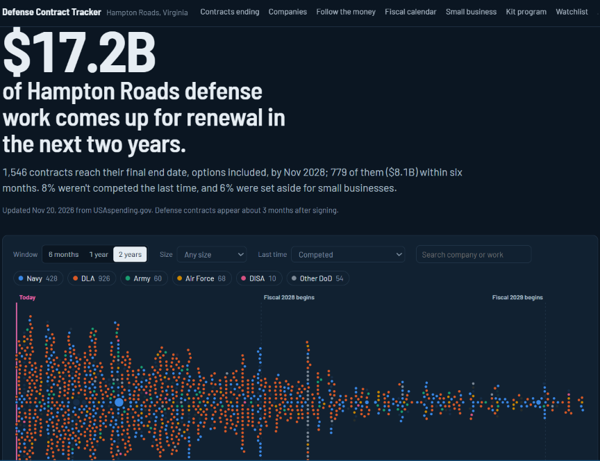
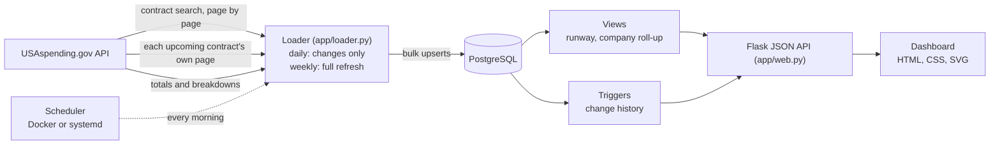

# Defense Contract Tracker · Hampton Roads

[](https://github.com/cox4hm/defense-contract-tracker/actions/workflows/tests.yml)

**Which defense contracts in Hampton Roads, Virginia come up for renewal in the next two years, who holds them,
and where does the money go?**

A live dashboard built on USAspending.gov, the federal government's official record of contract spending, refreshed
automatically every day. It's built for the questions a business-development or capture team asks, written so a
non-specialist can follow it.

**Live demo:** _add your link here_



## What it does

- **The recompete runway.** Every Hampton Roads defense contract of $1 million or more that reaches its *final* end
  date (with every option exercised) in the next two years, one circle per contract, placed by month and sized by
  value. Filter by branch, size, how it was awarded last time, or search; the list below updates with it.
- **Contract pages:** obligated value, ceiling with all options, current and final end dates, whether it was
  competed and how many bids it drew, small-business set-asides, pricing type, buying office and a timeline.
- **Company profiles:** subsidiaries rolled up to their parent company, who buys from them, and what share of their
  work comes up for renewal soon.
- **Follow the money:** a flow diagram from the branch that buys, to the kind of work, to the company that does it.
- **The fiscal calendar:** five years of monthly obligations on a heat grid, showing the September year-end rush.
- **Small business:** the region's small-business share by year, the largest small-business contractors, and how
  the ending contracts were awarded.
- **The kit program:** the DLA special-operational-equipment program nationwide, its prime contractors and the
  suppliers behind them.
- **Watchlist and change feed:** follow any company across all of DoD; a daily feed of contracts that were extended,
  grew, or were newly awarded, written by the database itself.

## What this project demonstrates

| Area | In this project |
|---|---|
| **Data engineering** | A daily pipeline over a federal API with a 90-day reporting lag: fiscal-year-chunked full loads, changes-only daily updates using the API's last-modified filter, a few thousand per-contract detail reads that resume where they left off, retries and progress logs |
| **API contract testing** | The parsers are tested against real API responses saved in `tests/samples/`, plus data checks that warn when a field silently disappears |
| **SQL and database design** | PostgreSQL views that roll subsidiaries up to parents, triggers that record history the source doesn't keep, fiscal-year and reporting-lag functions, bulk upserts |
| **Backend** | A Flask JSON API and a token-protected admin page for the watchlist and settings |
| **Data visualization** | Hand-built SVG with no chart library: a beeswarm timeline, a Sankey flow diagram, a calendar heat map; a colorblind-safe palette checked with a validator; light and dark modes |
| **Product thinking** | Built around one question a capture team asks first ("what's coming up for re-bid?"), with honest caveats on the page |
| **Operations** | Docker Compose, systemd timers on Ubuntu, a scheduler that catches up after the laptop sleeps, unit tests in GitHub Actions |
| **Domain knowledge** | Federal fiscal years, obligations vs. outlays, option periods, extent competed, set-aside programs, NAICS and PSC codes |

## Architecture



## Run it

You need [Docker Desktop](https://www.docker.com/products/docker-desktop/) (Windows, macOS or Linux).

```bash
git clone https://github.com/cox4hm/defense-contract-tracker.git
cd defense-contract-tracker
docker compose up -d --build
```

Open **http://localhost:8001**. The first load downloads every Hampton Roads contract of $1 million or more from the
last five fiscal years (a few minutes), then reads each upcoming contract's own page for its options and competition
details. That part takes 30 to 60 minutes; the dashboard works throughout and sharpens as pages arrive. Watch it with
`docker compose logs -f scheduler`. After that, a daily update downloads only what changed. To set an admin password,
create a `.env` file with `ADMIN_TOKEN=something-long` before starting.

<details>
<summary>Other ways to run it, and everyday commands</summary>

### Ubuntu without Docker

```bash
git clone https://github.com/cox4hm/defense-contract-tracker.git
cd defense-contract-tracker
bash deploy/setup_ubuntu.sh
```

The script installs PostgreSQL (if needed), creates the database, runs the first load, schedules a daily update at
6:40 a.m. Eastern and starts the dashboard at **http://localhost:8001**. It prints an admin token at the end; it's
also saved in `.env`.

### Everyday commands

```bash
# Docker
docker compose logs -f scheduler              # watch updates
docker compose exec -T db psql -U defense defense_tracker < db/demo_queries.sql   # example SQL
#   (PowerShell: Get-Content db/demo_queries.sql | docker compose exec -T db psql -U defense defense_tracker)
docker compose down                           # stop (data is kept); add -v to wipe the database

# Ubuntu without Docker
set -a && . ./.env && set +a                  # load settings into the shell
.venv/bin/python -m app.loader                # update now (and read any contract pages still due)
.venv/bin/python -m app.loader --step details # just one part: awards | details | totals | kits | watchlist
journalctl -u dct-loader.service -n 50        # last update's log
.venv/bin/python -m pytest -q tests           # unit tests
bash deploy/update.sh                         # after pulling a new version
```

</details>

## How it works

### The data

| Step | What it downloads | How often |
|---|---|---|
| `awards` | Every DoD contract of $1M+ performed in the 14 Hampton Roads cities and counties, five fiscal years | All of it weekly; only what changed (last-modified filter) on other days |
| `details` | Each upcoming contract's own page: options and final end date, ceiling, extent competed, bids, set-aside, pricing, parent company, business size | New and changed contracts only; resumes where it left off |
| `totals` | Monthly and yearly totals (including the many small orders), and breakdowns by branch, industry, product, city and company | Daily |
| `kits` | The DLA kit program's master contracts (order counts and totals from each one's page), their largest orders, and subcontracts reported on those orders | Daily |
| `watchlist` | Every DoD contract for each company on the watchlist | Daily |

### Defining "comes up for renewal"

A contract's current end date isn't when it ends: most have options the government can exercise to extend them.
The runway uses the **final end date**, the last day the contract could run with every option used, read from each
contract's own page (`period_of_performance.potential_end_date`). A contract with years of options left drops off the
runway even if its current period ends next month. Until its page has been read, the current end date stands in.

### Messy-data decisions

- **The 90-day lag.** DoD publishes contract actions about 90 days after signing. The newest months are hatched as
  "still filling in", yearly breakdowns use the last *complete* fiscal year (`last_full_fy()`), and the about section
  warns that an "ending" contract may already have been extended.
- **One company, many names.** Contracts are filed under registrations like "HUNTINGTON INGALLS INC" and
  "HII MISSION TECHNOLOGIES CORP". They roll up by the parent company that USAspending lists on any of a company's
  contract pages (the loader reads at least one page for every company with $25M or more for this), then by a normalized name
  (`company_key()` drops punctuation and suffixes like Inc. and LLC).
- **Plain words.** NAICS sectors become "Engineering and technical services", set-aside codes become "8(a) program",
  branch names are shortened, and the shouting capitals in federal data are turned into readable names while keeping
  acronyms and hull numbers (USS, LHD 7, NAVSEA).
- **A program you can't search for by name.** The kit program's orders are described by the item bought ("GPS
  receiver"), never by the program, so a keyword search found nothing. The loader finds the program's master contracts
  instead (DLA contract numbers SPE8EJ-21-D-…), including ones it spots inside the IDs of orders it already loaded,
  then reads each one's totals and largest orders.
- **A busy server.** USAspending cuts off clients that send many requests in a row, and on the first live load it
  did. Requests now back off for up to two minutes, contract pages are read with a pause and a break every 250
  pages, a step that can't get an answer stops politely (everything read so far is kept), and the scheduler retries
  any failed step within the hour instead of waiting for the next morning.
- **APIs change without telling you.** In this project's sister dashboard, ClinicalTrials.gov silently stopped
  returning a field and every disease showed up as "Other". So here the parsers are tested against saved real
  responses, and the loader checks its own results: if most contract pages stop saying how a contract was competed,
  the update logs a warning and the admin page shows it.

### Database design

- **Tables** (`db/init/01_schema.sql`): `awards` (search fields plus contract-page fields), `monthly_totals`,
  `fy_totals`, `category_totals`, `companies` and `company_awards` (watchlist), `subawards`, `events`, `settings`,
  `localities`, `fetch_runs`.
- **Views** (`03_views.sql`): `v_company_awards` adds branch, parent roll-up, final end date and competition flags
  to every contract; `v_runway` is the recompete window; `v_companies` rolls everything up per company;
  `headline()` returns the numbers in the page title.
- **Triggers** (`02_functions.sql`) compare each update with the stored row and log contracts that were extended,
  grew, or are newly awarded. History only starts after the first complete load, so loading five years of data
  doesn't flood the feed.

### Visual design

The palette comes from a nautical chart of Hampton Roads: chart-paper background, deep-water ink, shallow-water blue
for highlights, and chart magenta used for one thing only, the "today" line in every time-based view. Type is
Barlow, a typeface inspired by highway and signage lettering. Data colors are a colorblind-safe palette checked with a
validator, and every colored mark also carries a text label. Light and dark modes are designed separately.

## Decisions and trade-offs

- **$1 million floor.** Hampton Roads has about 165,000 DoD contract awards in two years, mostly small purchase orders.
  Storing every one would slow every query for little insight, so contracts under $1M count in the totals and
  breakdowns (which USAspending adds up for us) but aren't stored one by one. The floor is a setting.
- **Contract pages are read one at a time.** Competition, options and parent company are only on each contract's own
  page. The loader reads them for upcoming contracts, biggest first, a capped number per run, and picks up where it
  left off, so the first load is slow but every later day reads only a handful.
- **Obligations, not outlays.** Obligations are the standard measure of contract spending and are complete; outlays
  (actual payments) lag and are often missing. The page says which one every number is.
- **No chart library.** Every chart is a few dozen lines of SVG, which keeps the page small and every mark accessible.

## Testing

```bash
python -m pytest -q tests
```

The unit tests run the parsers on real USAspending responses saved in `tests/samples/`, and cover fiscal dates,
date formats, filters, paging, the upsert rules and the missing-field check. They need no network or database, and
they run on every push through GitHub Actions (`.github/workflows/tests.yml`). During development the whole pipeline
was also run end to end against a fake API built from those real responses.

## Caveats

- DoD contract data is published about 90 days late, so a contract shown as ending may already have been extended,
  and recent months are incomplete.
- "Hampton Roads" is defined by where the work is performed, not where the company is based.
- Company roll-ups depend on how companies register; a few may be split or merged imperfectly.
- This is an educational project, not an official source for bid decisions.

## Ideas to extend it

- Link upcoming recompetes to SAM.gov opportunity notices (needs a SAM.gov API key).
- Email or Slack alerts for watchlist companies.
- Other regions: the locality list is a table, so any set of counties works.
- Forecast the September rush from prior years.

## Project layout

```
defense-contract-tracker/
├── app/
│   ├── config.py        settings from .env
│   ├── db.py            psycopg2 helpers
│   ├── usaspending.py   USAspending client + parsing
│   ├── loader.py        daily ETL (CLI)
│   ├── scheduler.py     daily loop for Docker
│   ├── web.py           Flask app: dashboard, JSON API, admin
│   ├── templates/       HTML
│   └── static/          app.js, viz.js (no-library charts), style.css
├── db/init/             01 schema · 02 functions/triggers · 03 views · 04 seed
├── db/demo_queries.sql
├── deploy/              setup_ubuntu.sh, update.sh, systemd units, crontab example
├── tests/               unit tests + real API samples (no network or database needed)
└── Dockerfile, docker-compose.yml, requirements.txt, .env.example
```

## About

Built by **Harper Cox**, Integrated Science and Technology (biotechnology concentration), James Madison University.
One of a series of public-data dashboards; see also the
[Biotech Pipeline Radar](https://github.com/cox4hm/biotech-pipeline-radar).

- LinkedIn: _add your link_
- Email: _add your email_

Data: [USAspending.gov](https://www.usaspending.gov) (U.S. Department of the Treasury). Code released under the MIT
License.
